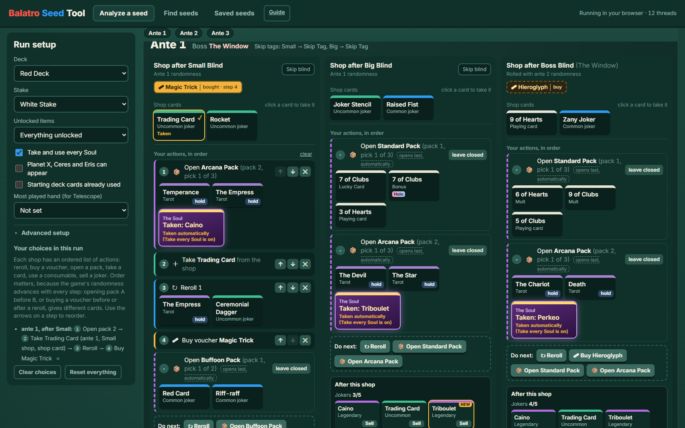

# Balatro Seed Tool

Analyze any Balatro seed (shops, packs, vouchers, tags, bosses, every Soul), plan a run **step by step in the order you would really play it**, and search millions of seeds for the ones you want. It reproduces the game's own random number generator, so what you see is what the game will give you.

**▶ Use it online: https://abderahmaneh.github.io/balatro-seed-tool/** (works on phones too; nothing to install)



## Quick start

| I want to… | Do this |
|---|---|
| Just use it | Open the [online version](https://abderahmaneh.github.io/balatro-seed-tool/), or download **`Balatro Seed Tool.html`** and double-click it. Runs in the browser, offline, nothing to install. |
| Search faster | [Download the repository](https://github.com/AbderahmaneH/balatro-seed-tool/archive/refs/heads/main.zip), then double-click **`Start Balatro Seed Tool.bat`** (Windows) / **`.command`** (macOS) / `./start.sh` (Linux), or `python src/app.py`. Needs Python 3.8+. A C compiler (gcc/clang) adds the fast engine; `pip install pyopencl numpy` adds the GPU engine. The page finds the app on its own. |
| Use the command line | `python src/analyze.py ALEEB --antes 8` · `python src/find_seeds.py --want legend:any:1:count=2 --length 1-8` |

## The analyzer

* **Every shop is an ordered list of actions**: reroll, buy a voucher, open a pack, take a card, use a consumable, sell a joker. Steps run top to bottom and can be moved with ↑ ↓. Order changes the result, exactly like in the game: pack A before pack B, a voucher before or after a reroll, a voucher after the Big Blind versus after the Boss Blind.
* **Trays after each shop** show your jokers (with free slots, **NEW** marks and what was lost) and your consumables, with **Sell** / **Use** buttons right there. **Your run now** at the top shows where you stand.
* Click any card to take it. Souls, Judgement, Wraith, Wheel of Fortune, Hex, Ectoplasm, Ankh, The Fool, Perkeo and more are simulated.
* **Find a card in this seed** lists every way a joker, tarot, planet or voucher can show up (rerolls, packs, skip tags…) and applies it with one click.
* **Undo** (Ctrl+Z), save seeds, export to Markdown / text / JSON.

## The finder

Describe the seed you want (*"2 legendaries in ante 1"*, *"Negative Blueprint by ante 2"*, …) and search in the browser, with the C engine or on the GPU. The finder keeps a fixed order inside a shop (vouchers → rerolls → packs left to right); the analyzer is the one that follows your own order.

## Repository layout

```
Balatro Seed Tool.html        the whole app in one file (generated, commit it so people can double-click)
Start Balatro Seed Tool.*     launchers for the local app
ui/                           page template (index.html), JavaScript engine (engine.js), game data (data.json)
src/                          Python app + CLI, reference engine, C / OpenCL search engine
data/game_data.json           game data tables (items, pools, weights, tags, blinds) extracted from game.lua
tools/                        build script and regression tests
docs/                         GUIDE.md, screenshot
index.html                    redirect for GitHub Pages
```

## Development

```
python tools/export_game_data.py  # refresh data/game_data.json from data/game.lua (after a game update)
python tools/build_ui.py       # rebuild "Balatro Seed Tool.html" from ui/ + game data
python tools/gen_js_data.py    # regenerate ui/data.json after a game update
python tools/gen_data.py       # regenerate src/core_data.h after a game update
python tools/difftest_js.py    # JS engine vs Python engine (needs node)
python tools/difftest.py       # Python engine vs C engine (needs gcc/clang)
python src/gpu_search.py --selftest
```

After editing `ui/index.html` or `ui/engine.js`, run `python tools/build_ui.py` and commit the regenerated `Balatro Seed Tool.html`.

**Game data:** `game.lua` is part of Balatro and is **not** included in this repository. The engines run from `data/game_data.json` (item names, pool order, weights). To refresh it after a game update, copy `game.lua` from your own install (`Balatro.exe` is a zip archive; on macOS open `Balatro.love` inside the app bundle) into `data/` and run the scripts above. It is git-ignored.

Full documentation: [docs/GUIDE.md](docs/GUIDE.md).

## Accuracy

The RNG functions, pools and shop logic follow the game's code line by line. A few parts (pack opening, tags, some consumable effects) are reconstructed and match every seed tested so far; see *How exact is it?* in the guide. If you find a seed where the tool and the game disagree, please [open an issue](https://github.com/AbderahmaneH/balatro-seed-tool/issues) with the seed, deck, stake and what you did.

## License

The code is MIT-licensed (see [LICENSE](LICENSE)).

*Fan-made tool, not affiliated with or endorsed by LocalThunk or Playstack. Balatro is their game; buy it, it's great.*
