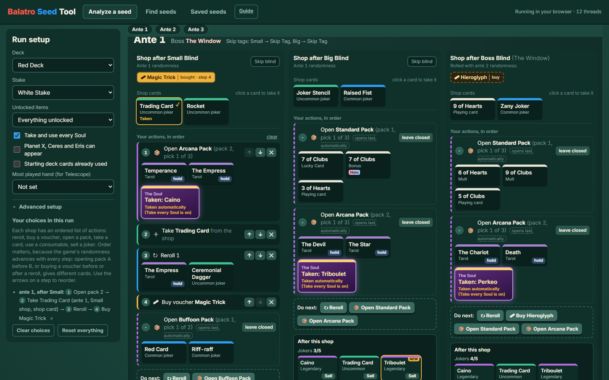

# 1. What this is

Two tools that reproduce Balatro's random number generator from the game's own code (`game.lua`, `misc_functions.lua`, `common_events.lua`, `UI_definitions.lua`):

| Tool | What it does |
|---|---|
| **The app** (`app.py`) | Everything below in your browser: an interactive analyzer where you click to take, buy, skip and reroll, a condition builder for the finder with live progress, and saved seeds. |
| **`analyze.py`** — seed analyzer | Type a seed and see the whole run: every shop of every ante, both packs in every shop and what is inside them, every Soul and which legendary it gives, vouchers, skip tags, bosses, reroll previews. |
| **`find_seeds.py`** — seed finder | Give criteria (e.g. *"3 legendaries in ante 1"*, *"Negative Blueprint by ante 2"*) and get seeds that match. Uses a fast C engine (all CPU cores) or an OpenCL GPU engine. Every hit is re-checked by the independent Python engine. |

Both tools share the same rules and the same options, so a seed found by the finder looks exactly the same in the analyzer.

## Quick start: the app

There are three ways to open the same app. All of them work the same way.

| Way | What you need | Search engine |
|---|---|---|
| Double-click **`Balatro Seed Tool.html`** | nothing (any modern browser, works offline) | your browser, all CPU threads (about 15–35 thousand seeds/s per thread) |
| The hosted page (GitHub Pages link in the README) | a browser on any device, including your phone | your browser |
| **`Start Balatro Seed Tool.bat`** (Windows) / **`.command`** (macOS) / `python src/app.py` | Python 3.8+; gcc or clang for the fast engine | adds the C engine (several times faster) and the GPU engine |

The page has its own copy of the engine (`ui/engine.js`, a JavaScript port checked event by event against the Python engine), so analysing seeds and searching never needs a server. When `app.py` is running, the page finds it automatically, even when you open the `.html` file from disk, and offers its faster engines under *Engine*. If the page can't save files where it is hosted, Markdown/Text/JSON exports open in a box you copy from.



**Analyze a seed.** Type a seed of 1–8 characters (letters that seeds never use are ignored as you type) and press Analyze. Each ante is a row with three shops: after the Small, Big and Boss Blind. Every shop shows its voucher, both shop cards and both packs with their contents. Souls glow purple and show the legendary they give, and all legendaries are summarised at the top. The page is interactive, and every click re-simulates the run from that point:

| Click | Effect |
|---|---|
| a joker in a shop or an opened pack | click it to take it; it joins **Your jokers**. |
| a Tarot, Planet or Spectral | click it to **use it now**, or press its **hold** button to keep it for later. Using it shows the result under the pack: The Emperor and High Priestess show the 2 cards they create, Judgement and Wraith the joker, Wheel of Fortune whether it hit and which edition, Hex/Ectoplasm/Ankh which joker they hit and what was destroyed, The Fool what it copies, The Soul the legendary. |
| a held consumable | it shows in the **tray** under each shop ("After this shop") with a **Use** button. Pressing it adds a *Use* step to that shop's action list, so you can hold Ectoplasm or The Fool and use it a few shops later; effects that target your jokers (Hex, Ectoplasm) use the jokers you have at that point. |
| created cards | cards a used card creates (Emperor's tarots, etc.) can be clicked to use now, or held; otherwise you keep them. A pack only lets you take as many cards as it allows. Click a taken card again to undo; click a Soul to leave it. |
| **Skip blind** | skip that blind: no shop, you get its tag (tag packs open, Boss Tag rerolls the boss, Rare/Uncommon/edition tags change the next shop) |
| **↶ Undo** / Ctrl+Z | take back your last choice |

**Order matters (version 13).** Each shop has an ordered list of *actions* under the shop cards: **Reroll**, **Buy a voucher**, **Open a pack**, **take a card**, **Use** a consumable, **Sell** a joker. Press the "Do next" buttons to add a step; the steps are simulated top to bottom, and you can move a step with the ↑ ↓ arrows or delete it with ✕. Because Balatro's random streams advance every time something draws from them, the order changes what you see:

* opening Arcana pack 2 before pack 1 gives pack 2 the cards pack 1 would have had;
* buying a voucher before or after a reroll (Tarot Merchant, Magic Trick, Overstock…) changes the later rerolls;
* buying a voucher in the shop after the Big Blind is not the same as buying it after the Boss Blind (the Boss shop is rolled with the next ante's randomness and has the next ante's voucher);
* taking a joker before opening a Buffoon pack changes how many slots are free.

Packs you did not open explicitly are opened automatically, left to right, after your steps (dashed box); use **leave closed** to skip one. Taking a shop card adds a step right before the reroll that would remove it.

Under every shop a **tray** shows your jokers (with empty slots) and consumables after that shop, with **NEW** marks and what was lost; **Sell** / **Use** there add a step at the end of that shop. **Your run now** at the top shows the end of the last shop.

| **Peek rerolls** | show what the next N rerolls of every shop would give, without changing anything |

**Find a card in this seed** (under the seed box): type a card — a joker, tarot, planet, spectral (including The Soul) or voucher — or a rarity such as *Any Rare joker*. Pick an edition (Negative, Foil, …) to narrow it, and how many rerolls per shop to check, then press Find. It lists every way that card can show up in the antes you're viewing: shop cards and vouchers, after N rerolls of a shop, the matching packs (Buffoon for jokers, Arcana for tarots, Celestial for planets, Spectral, Standard), The Soul for legendaries, using a Judgement or Wraith you can find, and skipping a blind for the tag that brings it (Buffoon/Uncommon/Rare/Top-up for jokers, Charm, Meteor, Ethereal, Standard or Voucher tags for the rest). Each way is checked by simulating it, starting from your current choices. **Show me** applies what's needed and scrolls to the card. The list updates as you change your choices.

**Selling a joker.** Each joker in the **Your jokers** panel has a **sell** button (it sells at the last shop); for a specific point, use the **sell** button on the "Your jokers after this" line under that shop. Selling it there frees a joker slot and removes it from the "already seen" set, so it can appear again in later shops and packs. Sell effects that create cards are simulated: **Diet Cola** creates a free Double Tag (exact), and **Invisible Joker** duplicates a random one of your jokers with the copy losing Negative — its specific pick is marked *reconstructed* because that RNG key wasn't available when the engine was built, so verify it in game. **Luchador** and a few others show a note instead, since they don't create a card.

**Your jokers** (above the antes) shows the jokers and consumables you have at the end, with free slots. Under every shop a line shows your jokers after that shop: new ones are outlined, destroyed ones are struck through. If you own Perkeo, each shop ends with its Negative copy of a random held consumable. Set *Perkeo copies per shop* to 2 or 3 when Blueprint/Brainstorm copy it. *Always take these jokers* (left panel) takes a joker every time it shows up, which is also what the finder uses.

Your choices are listed on the left under *Your choices in this run*, where you can remove them one by one. They are cleared when you open a different seed. The left panel also sets the deck, stake, unlocks, jokers you already own, items still locked on your profile and your most played hand. **Markdown / Text / JSON** download the whole analysis. **Save** stores the seed in *Saved seeds*.

**Find seeds.** Build conditions (*Where* + *What* + *Antes* + *At least*, plus rarity, edition, seal, enhancement, which shops and *within N rerolls*), or start from a preset such as *2 legendaries in ante 1*. Choose the engine, the seed lengths, shortest-first or random order, how many seeds to check and when to stop. Then press **Find seeds**. Results stream in with a progress bar, speed and time left. Click a seed to open it in the analyzer, or press ★ to save it. Export the results as CSV or Markdown. By default a search uses only the run setup (deck, stake, unlocks…). Tick *Also apply my choices* to search with your skips, purchases and rerolls too.

**Saved seeds** keeps your seeds with editable notes in this browser. Use Export / Import to back them up or move them to another computer.

## Quick start: command line

```
python src/analyze.py ALEEB
python src/analyze.py ALEEB --antes 8 --format md --out ALEEB.md
python src/find_seeds.py --want legend:any:1:count=2
```

Requirements: **Python 3.8+** (nothing else for the analyzer).
The finder's fast engine is compiled automatically if **gcc** or **clang** is installed (Linux/macOS have it; on Windows install *MSYS2/MinGW* or use WSL). Without a compiler use `--engine py` (slow) or `--engine gpu` (needs `pip install pyopencl numpy`). All game data (jokers, pools, weights) is read from `data/game_data.json`, which is extracted from the game's `game.lua` (see *Updating the game data* in section 8).

# 2. Two details that are easy to get wrong

Earlier versions got the shops wrong while still getting the legendaries right. Two details caused it:

1. **Shop timeline.** Balatro has three shops per ante, and **the shop after the Boss Blind is already rolled with the next ante's number**: beating the boss runs `ease_ante(1)` before that shop opens. A tool that shows one shop per ante calls your third shop "ante 2 shop 1". The legendary still looked right only because the legendary stream (`Joker4`) has no ante in its key.
2. **Cards that already exist are excluded.** The game marks every card that exists (in the shop, in an open pack, in your jokers) in `G.GAME.used_jokers`, and `get_current_pool` skips those, so you can't get a duplicate. Ignoring this means the 2nd card of a pack or the 2nd shop slot could differ. This also covers:
   - only one Soul (and one Black Hole) per pack, because once one exists in the open pack, the 0.3% roll is skipped entirely;
   - legendaries you already own are excluded from the next Soul.

With both handled, ALEEB has a Soul in all three shops of ante 1 (**Caino, Triboulet, Perkeo**), and ante 2 continues with Chicot and Yorick.

# 3. How Balatro's randomness works (short)

* A seed is **1 to 8 characters** from `1-9 A-N P-Z` (34 symbols; never `0` or `O`). Short seeds are real seeds: `A`, `ZZ` and `ALEEB` all work. There are 34 one-character seeds, 1,156 two-character seeds, …, 34⁸ ≈ 1.78 trillion eight-character seeds, about 1.84 trillion in total.
* Every kind of random event has its own **stream**, named by a key plus the ante number, e.g. `cdt1` (shop slot type in ante 1), `Joker2sho1` (uncommon shop joker), `Tarotar11` (tarot in an Arcana pack, ante 1), `soul_Tarot1` (Soul chance), `shop_pack1`, `Voucher2`, `Tag2`, `boss`.
  Each stream advances only when used, so **what you do changes what comes next in that stream**: rerolling advances the shop stream, and opening a pack advances that pack type's stream.
* **Shop order per ante.** The shops whose RNG uses ante *k* are: the shop after the Boss of ante *k−1*, then after the Small and Big Blind of ante *k*. The analyzer shows shops in game order and labels the boss shop:

| Game ante | Shop after Small | Shop after Big | Shop after Boss |
|---|---|---|---|
| 1 | RNG ante 1 | RNG ante 1 | **RNG ante 2** (+ ante-2 voucher) |
| 2 | RNG ante 2 | RNG ante 2 | **RNG ante 3** |

* The very first shop pack of the run is always a Buffoon Pack.
* The Soul: every card of an Arcana or Spectral pack has a 0.3% chance to be The Soul. When used, it gives a legendary from the `Joker4` stream, which is shared by the whole run, so the 1st Soul you use always gives the seed's "first legendary" (the game's own `get_first_legendary`).

# 4. The analyzer — `analyze.py`

```
python src/analyze.py SEED [options]
```

What it prints for every ante: boss, both skip tags, then each of the 3 shops with its voucher, the 2 shop cards (plus reroll results if asked), both packs with their contents (editions, seals, enhancements, stickers), and every Soul with the legendary and its edition. A summary of all legendaries comes first.

## Output options

| Option | Meaning |
|---|---|
| `--antes N` | how many antes to show (default 3, no upper limit) |
| `--preview-rerolls N` | also show what the next N rerolls of each shop would give, without changing the run |
| `--format text / md / json` | screen text, Markdown, or JSON for your own scripts |
| `--out FILE` | save to a file |

## Run setup (same in both tools)

| Option | Meaning |
|---|---|
| `--deck NAME` | Red (default), Blue, Yellow, Green, Black, Magic, Nebula, Ghost, Abandoned, Checkered, Zodiac, Painted, Anaglyph, Plasma, Erratic. Affects: Ghost (spectral cards in shop, starts with Hex), Magic (Crystal Ball, 2 Fools), Nebula (Telescope), Zodiac (Tarot/Planet Merchant, Overstock), Black/Painted (joker slots). |
| `--stake N` | 1–8 or White…Gold. Black and above show Eternal; Orange shows Perishable; Gold shows Rental. Stickers never change which cards appear. |
| `--unlocked all / fresh` | `all` (default) = everything unlocked. `fresh` = a new profile: locked jokers/vouchers and tags whose item isn't discovered can't appear. |
| `--locked A,B,...` | jokers/vouchers still locked on *your* profile (for a partly unlocked save) |
| `--planets-played` | Planet X / Ceres / Eris can appear (you played those secret hands) |

## What you do during the run

These change the results from the moment they happen.

| Option | Example | Meaning |
|---|---|---|
| `--skip` | `--skip 1s,2b` | skip blinds (s = Small, b = Big). No shop after a skipped blind; you get its tag. Pack tags (Charm, Buffoon, Meteor, Ethereal, Standard) open their pack, Boss Tag rerolls the boss, Double Tag copies the next tag, Uncommon/Rare/edition tags change the next shop's first joker, Voucher Tag adds a voucher, Top-up Tag creates 2 commons. |
| `--reroll` | `--reroll 1s=2,2b=1` | reroll a shop that many times. Shop ids: `1s` `1b` `1x` = after Small / Big / Boss of ante 1. |
| `--skip-pack` | `--skip-pack 1s.1,tag:Charm` | don't open pack 1 of shop 1s / packs from Charm Tags |
| `--buy-voucher` | `--buy-voucher "Overstock,Magic Trick"` | buy these vouchers as soon as they are offered. Effects are modelled: Overstock(+) adds a slot immediately, Tarot/Planet Merchant/Tycoon, Magic Trick, Illusion, Hone, Glow Up, Omen Globe, Telescope. Buying a voucher unlocks its upgrade in later antes. |
| `--take` | `--take "Blueprint,Showman"` | buy or pick these whenever they show up (they become yours and stop appearing; needs a free joker slot) |
| `--own` | `--own Showman` | jokers you already have (Showman allows duplicates) |
| `--no-souls` | | don't take The Soul (default: every Soul is taken and used immediately if there is a free joker slot) |
| `--most-played` | `--most-played Flush` | your most played hand; only needed with Telescope (first Celestial card) |
| `--start-consumables held / used` | | whether the Magic/Ghost deck starting cards are still in hand |

The order inside each shop is assumed to be: buy vouchers → buy `--take` cards → rerolls → open packs left to right. (The browser analyzer is more flexible: you choose the order yourself. The finder and the command line keep this fixed order.)

# 5. The finder — `find_seeds.py`

```
python src/find_seeds.py --want CRITERION [--want CRITERION ...] [options]
```

All criteria must match (AND). A criterion is:

```
LOCATION:ITEM[:ANTES][:option=value ...]
```

| LOCATION | matches |
|---|---|
| `shop` | a card in a shop slot (joker, tarot, planet, spectral, playing card) |
| `pack` | a card inside a booster pack you open (shop packs and tag packs), including `The Soul` / `Black Hole` |
| `legend` | a legendary you get from a Soul (`any` or a name) |
| `joker` | a joker anywhere: shop slot, Buffoon pack, from the Soul, from a Top-up Tag |
| `voucher` | voucher offered in a shop of that ante |
| `tag` | one of the two skip tags of that ante |
| `boss` | the boss of that ante |
| `packtype` | booster offered in a shop (e.g. `Mega Arcana Pack`) |
| `card` | a playing card (Standard packs, or shop with Magic Trick), e.g. `Ace of Spades` or `any` |

`ITEM` = in-game name (`Blueprint`, `Perkeo`, `The Soul`, `Negative Tag`, `The Plant`) or key (`j_blueprint`), `any`, or a joker rarity: `common`, `uncommon`, `rare`, `legendary` (for `shop`, `pack`, `joker` and `legend`).
`ANTES` = in-game ante or range: `1`, `1-3` (search supports up to ante 39).

| option | meaning |
|---|---|
| `count=N` | at least N occurrences (e.g. `legend:any:1:count=3` = three legendaries in ante 1) |
| `rarity=` | only jokers of this rarity: `common`, `uncommon`, `rare`, `legendary` (e.g. `joker:any:1-2:rarity=rare:count=2` = two Rare jokers by ante 2; `joker:rare:1-2:count=2` is the same) |
| `edition=` | `foil`, `holo`, `polychrome`, `negative` |
| `seal=` | `red`, `blue`, `gold`, `purple` (playing cards) |
| `enh=` | enhancement for `card`, e.g. `enh=Glass Card` |
| `shop=` | only these shops: `s`, `b`, `x` (after Small/Big/Boss) or `tag` (tag packs); combine with `+`, e.g. `shop=s+b` |
| `rerolls=N` | also accept it if it shows up within N rerolls of a shop (each shop checked as if you rerolled only there) |

## Search options

| Option | Meaning |
|---|---|
| `--length L` | seed lengths to search: `8`, `1-8` (default), `3-5`… Seeds are checked shortest first (`1`…`Z`, then `11`…), so all seeds up to 5 characters (46.8 million) can be checked completely. |
| `--count N` | how many seeds to scan (default 20 million) |
| `--from SEED` | start the scan at this seed |
| `--start N` | start at this position in the length range (0 = first seed) |
| `--random S` | scan random seeds instead of consecutive ones |
| `--hits N` | stop after N seeds (default 10) |
| `--engine auto / cpu / gpu / py` | `auto` = compiled C if a compiler exists, else Python |
| `--threads N` | CPU threads (default: all) |
| `--out FILE` | save results as `.md`, `.csv` or `.txt` |
| `--show` | print the full analyzer output for every hit |
| *run setup / during-run options* | exactly the same as the analyzer (deck, stake, skips, rerolls, vouchers, take, …) |

## Examples

```
# every seed of 1 to 4 characters with a legendary in ante 1
python src/find_seeds.py --want legend:any:1 --length 1-4 --hits 100

# 2 or 3 legendaries in ante 1 (ALEEB-like)
python src/find_seeds.py --want legend:any:1:count=2
python src/find_seeds.py --want legend:any:1:count=3 --count 200000000

# Perkeo by ante 2 and Blueprint by ante 3
python src/find_seeds.py --want legend:Perkeo:1-2 --want shop:Blueprint:1-3

# two Rare jokers by ante 2, and a Rare joker in the very first shop
python src/find_seeds.py --want joker:rare:1-2:count=2
python src/find_seeds.py --want shop:rare:1:shop=s

# a Negative joker of any kind in ante 1, plus Telescope offered
python src/find_seeds.py --want joker:any:1:edition=negative --want voucher:Telescope:1

# Blueprint reachable with up to 10 rerolls in one ante-1 shop
python src/find_seeds.py --want shop:Blueprint:1:rerolls=10

# a Red Seal Glass Ace of Spades in a Standard pack in ante 1-2
python src/find_seeds.py --want "card:Ace of Spades:1-2:seal=red:enh=Glass Card"

# skip both ante-1 blinds; one gives a Charm Tag whose Mega Arcana Pack has a Soul
python src/find_seeds.py --want "tag:Charm Tag:1" --want legend:any:1:shop=tag --skip 1s,1b

# Magic deck, buying Omen Globe, Soul by ante 2, random sample, saved
python src/find_seeds.py --want legend:any:1-2 --deck Magic --buy-voucher "Crystal Ball,Omen Globe" --random 42 --out seeds.md
```

## How rare things are

Measured with the default rules (Red Deck, everything unlocked):

| Criterion | Roughly |
|---|---|
| ≥1 legendary in ante 1 (any of 6 packs) | 1 in 55 seeds |
| ≥2 legendaries in ante 1 | 1 in 8,500 seeds |
| 3 legendaries in ante 1 (like ALEEB) | about 1 in 2 million seeds (14 in a 30M random sample) |
| Blueprint in a shop slot, antes 1–2 | about 1 in 50 seeds |

Speed on a 2-core machine: about 400,000 seeds/s for Soul/legendary searches and 80,000–200,000 seeds/s for shop and pack searches. A typical 8-thread PC is about 4× faster.

# 6. How exact is it?

**Taken line by line from the game's code (exact):** `pseudohash`, `pseudoseed`, `pseudorandom`, `pseudorandom_element`, LuaJIT's `math.random` (constants checked against the LuaJIT source), `get_current_pool` (rarities, unlock flags, existing-card exclusion, resampling), `create_card` (Soul/Black Hole rolls, editions, stickers), `create_card_for_shop` (slot types, Magic Trick/Illusion, tag jokers), `get_pack` (weights, first Buffoon pack), `get_next_voucher_key` (including Voucher Tag), `get_next_tag_key`, `get_new_boss`, `change_shop_size` (Overstock), the blind-select tag trigger order (`Game:update_blind_select`), and the shop sequence in `game.lua`.

**Reconstructed (these files were not used to build the engine)** (`card.lua`, `tag.lua`, `state_events.lua`, `button_callbacks.lua`):

* Pack contents (`Card:open`): stream suffixes `ar1`, `ar2`, `pl1`, `spe`, `sta`, `buf`, Standard-pack roll order, Telescope and Omen Globe.
* `G.GAME.used_jokers` is set when a card is created and cleared when it is removed.
* The Soul's legendary uses suffix `sou`. Tag jokers use `uta`, `rta` and `top`. A skipped blind triggers tags the same way as the blind-select screen.
* New voucher, tags and boss are rolled after beating the boss, with the new ante number.
* Voucher effects: Merchant ×2.4, Tycoon ×8, Magic Trick, Hone/Glow Up rates.
* What a used card does (analyzer only): the random keys `emp`, `pri`, `jud`, `wra`, `fool`, `wheel_of_fortune` (1 in 4), `hex`, `ectoplasm`, `ankh_choice`, `perkeo`, Ankh needing a free slot, and consumable slots (2 plus 1 per Negative card). Effects on the cards in your hand (Death, Strength, Cryptid, Sigil…) and money are described but not simulated, because your hand isn't simulated.

The ALEEB result (a Soul in all three ante-1 shops, with the correct legendaries) supports the timeline and the pack reconstruction.

**Not simulated:**

* your deck order and hands (`cardarea.lua` shuffle);
* jokers/tarots that create cards (Riff-raff, Judgement, Cartomancer, 8 Ball, …) — they only matter here because the cards they create stop appearing in shops while you hold them (add them with `--take`/`--own` if needed);
* Director's Cut / Retcon boss rerolls;
* **Hieroglyph / Petroglyph** (they lower the ante, which changes every stream after that point);
* selling cards back to the shop; the Orbital Tag's hand (no effect on items).

**Validation done:**

* The JavaScript engine matches the Python engine event by event on 810 random seeds/option mixes and on 150 full analyzer pages. It also finds exactly the same seeds as the C engine on 10 test searches.
* The Python engine and the C/GPU engine were written separately and compared event by event on 750+ random seeds with random option mixes (decks, skips, rerolls, vouchers, take lists, locked items, previews) over 8 antes, with no differences.
* The OpenCL kernel was compiled with clang, and its exact source was also run as C and matched the CPU engine's hits.
* The fast "only what the criterion needs" paths were proven to give identical hits to the full simulation.
* The first Soul's legendary always equals the game's own `get_first_legendary`.

**Not done:** running the GPU kernel on a real GPU (no GPU was available). Run the self-test below.

# 7. GPU

```
pip install pyopencl numpy
python src/gpu_search.py --selftest      # must print SELFTEST PASSED
python src/gpu_search.py --bench         # real speed on your card
python src/find_seeds.py --engine gpu --want legend:any:1:count=2 --count 500000000
```

The hashing needs double precision, which GeForce cards run at 1/64 speed. A budget card may only match a good multi-core CPU, so check `--bench` and use whichever is faster. Every GPU hit is still re-checked on the CPU.

# 8. Files

| File | Purpose |
|---|---|
| `Balatro Seed Tool.html` | the whole app in one file: double-click it (built by `tools/build_ui.py`) |
| `src/app.py`, `ui/index.html`, `ui/engine.js` | the local server, the page template and the JavaScript engine |
| `tools/build_ui.py`, `tools/gen_js_data.py` | rebuild `Balatro Seed Tool.html` from the game data |
| `tools/difftest_js.py` | regression test: Python vs JavaScript engine |
| `Start Balatro Seed Tool.bat` / `.command`, `start.sh` | double-click launchers |
| `src/analyze.py` | seed analyzer (command line) |
| `src/find_seeds.py` | seed finder (command line) |
| `src/searcher.py` | search jobs, seed space (1–8 characters), progress and stop, shared by the app and the command line |
| `src/engine.py` | reference engine: RNG, game data, the whole run simulation |
| `src/bridge.py` | criteria, options → C config, event stream shared by both engines |
| `src/core.h`, `src/core_data.h`, `src/search.c` | fast C/OpenCL engine (`core_data.h` is generated by `tools/gen_data.py`) |
| `src/gpu_search.py` | OpenCL host code, self-test, benchmark |
| `tools/difftest.py` | regression test: Python vs C on random seeds and options |
| `data/game_data.json` | the game data tables (items, pools, weights, tags, blinds) extracted from `game.lua` |
| `tools/export_game_data.py` | extracts `data/game_data.json` from your own `game.lua` |

**Updating the game data.** `game.lua` is part of Balatro and is not included here. After a game update, copy `game.lua` out of your own install (`Balatro.exe` is a zip archive; on macOS open `Balatro.love` inside the app bundle) into `data/`, then run `python tools/export_game_data.py`, `python tools/gen_data.py` and `python tools/build_ui.py`. When `data/game.lua` is present the engine reads it directly.

**Making it 100% exact:** the parts listed as reconstructed in section 6 could be replaced with the real logic from `card.lua`, `tag.lua`, `state_events.lua` and `button_callbacks.lua`. Contributions welcome.
